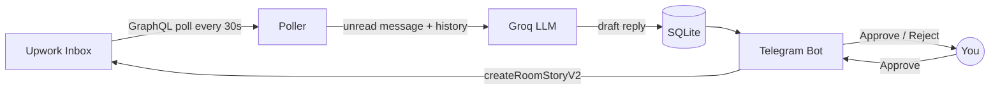
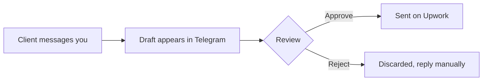

# 🤖 Upwork Message Draft Agent

### AI-Drafted Upwork Replies with Human-in-the-Loop Approval via Telegram

[](https://www.python.org/)
[](https://groq.com/)
[](https://core.telegram.org/bots)
[](https://www.upwork.com/developer)
[](https://www.sqlalchemy.org/)
[](https://docs.docker.com/compose/)

[Features](#-features) • [Quick Start](#-quick-start) • [Installation](#-installation) • [Deployment](#-deployment) • [Roadmap](#️-roadmap)

* * *

## 🎯 Overview

The Upwork Message Draft Agent watches your Upwork inbox, writes a professional reply to every new client message using a Groq-hosted LLM, and sends that draft to Telegram for review. **Nothing is ever sent to a client until you tap Approve.**

The goal is speed without losing control: by the time someone logs in to Upwork and opens a new chat, a ready-to-send reply is already waiting in Telegram.

### ✨ Why This Agent?

| Feature | Description |
|---|---|
| ⚡ **Fast drafts** | New unread messages are picked up within ~30 seconds and drafted in a few seconds |
| 🧑‍⚖️ **Human-in-the-loop** | Every reply needs an explicit Approve tap before it reaches Upwork |
| 🧠 **Context-aware** | Drafts use the last few messages of the conversation, not just the latest one |
| 🔁 **No duplicates** | Each client message gets exactly one draft, even across restarts |
| 🛡️ **Self-healing** | API errors are logged and retried on the next cycle instead of crashing the agent |
| 📱 **Works anywhere** | Approve or reject from the Telegram app on phone or desktop |

* * *

## 🚀 Quick Start

```
git clone https://github.com/Ajinkyaa2004/Upwork-Automation.git
cd Upwork-Automation
cp .env.example .env        # fill in your keys
docker compose up -d --build
```

Then send `/test` to your bot in Telegram.

**[Installation](#-installation) | [Configuration](#️-configuration) | [Deployment](#-deployment)**

* * *

## 📋 Table of Contents

- [Overview](#-overview)
- [Quick Start](#-quick-start)
- [Features](#-features)
- [Tech Stack](#️-tech-stack)
- [Architecture](#️-architecture)
- [Installation](#-installation)
- [Configuration](#️-configuration)
- [Usage](#-usage)
- [Project Structure](#-project-structure)
- [Deployment](#-deployment)
- [Roadmap](#️-roadmap)
- [Contributing](#-contributing)
- [Support](#-support)

* * *

## ✨ Features

### 📥 Upwork Monitoring

- Polls the Upwork GraphQL API for rooms with unread messages
- Fetches recent conversation history for context
- Only drafts for chats that are still unread, so it never interferes with conversations you've already handled
- Authenticates with the OAuth2 Client Credentials flow and refreshes tokens automatically

### ✍️ AI Draft Generation

- Uses Groq for low-latency LLM inference
- System prompt tuned for concise, polite, natural freelancer replies
- Model is configurable through an environment variable
- Empty or failed generations are retried on the next poll rather than sent as blank drafts

### ✅ Telegram Approval Flow

- Each draft arrives with the client's message and two buttons: **✅ Approve & Send** and **❌ Reject**
- Approve sends the exact draft text to the Upwork room
- Double-tap protection: a draft can only be handled once
- `/test` command generates a sample draft that is never sent to Upwork

### 🗄️ Persistence & Reliability

- SQLite database stores every draft with its status: `pending`, `sent`, `rejected` or `failed`
- Pending drafts survive restarts
- Health endpoint reports unhealthy if the poller stops completing cycles
- Bot token is kept out of request logs

* * *

## 🛠️ Tech Stack

### Backend

[](https://www.python.org/)
[](https://www.sqlalchemy.org/)
[](https://www.sqlite.org/)

### Integrations

[](https://www.upwork.com/developer)
[](https://groq.com/)
[](https://core.telegram.org/bots/api)

### DevOps

[](https://www.docker.com/)
[](https://ubuntu.com/)

#### Libraries

- **`python-telegram-bot`** — bot framework, inline keyboards and long polling
- **`groq`** — official Groq Python SDK
- **`sqlalchemy`** — ORM over SQLite
- **`requests`** — Upwork OAuth2 and GraphQL calls
- **`python-dotenv`** — environment variable loading

* * *

## 🏗️ Architecture



### Design Decisions

| Decision | Reason |
|---|---|
| Long polling for Telegram | No public URL, domain or open port required |
| Polling Upwork instead of webhooks | Works with the Client Credentials API key |
| One draft per Upwork story ID | Unread rooms stay unread between polls, so drafts would otherwise repeat |
| SQLite on a mounted volume | Simple, zero-maintenance storage that survives container rebuilds |
| Poller in a background thread | The poller and the bot run independently, so one failing doesn't stop the other |

* * *

## 💻 Installation

### Prerequisites

> - Python 3.12+ (or Docker with Compose)
> - An Upwork API key with access to messaging
> - A Groq API key from [console.groq.com](https://console.groq.com/)
> - A Telegram bot token from [@BotFather](https://t.me/BotFather) and the chat ID where drafts should arrive

### Quick Setup

#### 1️⃣ Clone the repository

```
git clone https://github.com/Ajinkyaa2004/Upwork-Automation.git
cd Upwork-Automation
```

#### 2️⃣ Configure environment variables

```
cp .env.example .env
```

Fill in the values described in [Configuration](#️-configuration).

#### 3️⃣ Run it

**With Docker (recommended):**

```
docker compose up -d --build
docker compose logs -f
```

**Without Docker:**

```
python -m venv .venv && source .venv/bin/activate
pip install -r requirements.txt
python -m src.main
```

#### 4️⃣ Verify

Send `/test` to your bot. You should receive a sample draft with Approve and Reject buttons.

> **Note:** Run only one instance per bot token. Two instances polling the same token will conflict.

### Common Issues

| Problem | Fix |
|---|---|
| `/test` returns an error about the model | The Groq model in `GROQ_MODEL` was retired. List available models with `curl https://api.groq.com/openai/v1/models -H "Authorization: Bearer $GROQ_API_KEY"` |
| `Conflict: terminated by other getUpdates request` | Another instance is running with the same bot token. Stop it |
| No drafts for real messages | The chat was opened on Upwork before the next poll. Only unread chats are drafted |
| Approve fails with a permission error | The Upwork API key may lack messaging scopes |

* * *

## ⚙️ Configuration

```
# Upwork API
UPWORK_CLIENT_ID=
UPWORK_CLIENT_SECRET=
UPWORK_TENANT_ID=            # organization ID from companySelector (optional)

# Groq
GROQ_API_KEY=
GROQ_MODEL=openai/gpt-oss-120b

# Telegram
TELEGRAM_BOT_TOKEN=
TELEGRAM_CHAT_ID=

# Behavior
POLL_INTERVAL_SECONDS=30
DATABASE_PATH=data/agent.db
```

| Variable | Default | Description |
|---|---|---|
| `GROQ_MODEL` | `openai/gpt-oss-120b` | Any chat model available on your Groq account |
| `POLL_INTERVAL_SECONDS` | `120` | How often Upwork is checked. 30 stays well within Upwork's API rate limit |
| `DATABASE_PATH` | `data/agent.db` | SQLite file location |
| `HEALTH_PORT` | `8000` | Internal health check port |

* * *

## 🎮 Usage



### 1️⃣ A client sends a message

Within about 30 seconds a draft arrives in Telegram, showing the client's message and the proposed reply.

### 2️⃣ Review the draft

| Button | Result |
|---|---|
| ✅ **Approve & Send** | The draft is posted to the Upwork conversation |
| ❌ **Reject** | The draft is discarded; reply on Upwork yourself |

### 3️⃣ Bot commands

| Command | Description |
|---|---|
| `/start` | Confirms the agent is running |
| `/test` | Generates a sample draft (never sent to Upwork) |

* * *

## 📂 Project Structure

```
Upwork-Automation/
├── src/
│   ├── main.py            # Entry point: health server, poller thread, Telegram bot
│   ├── config.py          # Environment variable loading
│   ├── upwork_client.py   # OAuth2 + GraphQL client (rooms, stories, send)
│   ├── poller.py          # Polling loop, dedup, draft creation
│   ├── llm.py             # Groq draft generation
│   ├── telegram_bot.py    # Bot commands, notifications, Approve/Reject handling
│   └── db.py              # SQLAlchemy Draft model
├── data/                  # SQLite database (created at runtime, git-ignored)
├── Dockerfile
├── docker-compose.yml
├── deploy.sh              # One-command deploy to a Linux server over SSH
├── requirements.txt
└── .env.example
```

* * *

## 🚀 Deployment

The agent only makes outbound connections, so it needs no domain, SSL certificate or open port.

### Option 1: Linux server with Docker (current setup)

The agent runs as a single Docker Compose service with `restart: unless-stopped`, a persistent `data/` volume, a 512 MB memory cap and log rotation.

`deploy.sh` automates the whole flow from your machine:

1. Verifies the Groq model exists and returns a real reply
2. Uploads the code and `.env` to the server with `rsync`
3. Builds the image and starts the container
4. Prints the container status and first log lines

```
bash deploy.sh
```

Edit the `KEY`, `HOST` and `DEST` values at the top of the script for your server.

### Option 2: Any container platform

Any host that runs a long-lived container works. Provide the environment variables and mount a persistent volume at `/app/data` so pending drafts survive restarts.

### Useful commands

```
docker compose ps                 # status and health
docker compose logs -f --tail 50  # live logs
docker compose restart            # restart the agent
```

* * *

## 🗺️ Roadmap

### ✅ Completed

- Upwork polling with conversation context
- Groq draft generation
- Telegram Approve / Reject flow
- Duplicate-draft prevention and double-tap protection
- Dockerized deployment with health checks

### 🚧 In Progress

- Verifying message sending with the current Upwork API scopes

### 📅 Planned Features

- Edit a draft in Telegram before approving
- Per-client tone and context memory
- Postgres support for multi-account scaling
- Daily summary of drafts sent and rejected

* * *

## 🤝 Contributing

1. 🍴 Fork the repository
2. 🌿 Create a branch: `git checkout -b feature/your-feature`
3. 💾 Commit your changes: `git commit -m "Add your feature"`
4. 📤 Push the branch: `git push origin feature/your-feature`
5. 🔃 Open a Pull Request

> Never commit `.env` or any real API keys.

* * *

## 💬 Support

### 🐛 Issues

Found a bug or have a feature request? [Open an issue](https://github.com/Ajinkyaa2004/Upwork-Automation/issues).

* * *

**Built with ❤️ by [Ajinkya Dhumal](https://github.com/Ajinkyaa2004)**
